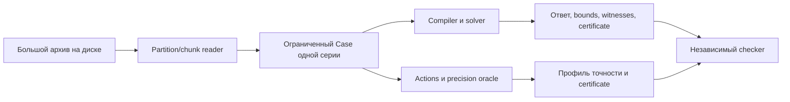

# MeteoBridge: подробное объяснение проекта с нуля

Отдельно подготовлены [обоснование предлагаемой новизны и сравнение работ](../reports/novelty_justification.md)
и [краткая формулировка научного вклада](../paper/novelty_statement_ru.md).

Версия объяснения: 2026-10-17. Документ описывает реализованный код и отдельно
отмечает исследовательские ограничения. Измерения и результаты находятся в
сохранённых runs; научная новизна и независимый review пока не подтверждены.

## 1. Какую проблему решает проект

Представим архив осадков. В нём написано: за сутки выпало 12 миллиметров.
Пользователь спрашивает: «Сколько выпало за первую половину этих суток?»

Суточная запись не содержит готового ответа. Все 12 mm могли выпасть утром,
вечером или распределиться между ними. Из одной этой записи следует только
диапазон от 0 до 12 mm. Деление 12 на два даёт удобное число 6, но приписывает
данным равномерный дождь, которого в исходной информации нет.

Теперь добавим вторую трудность. Непонятно, что означает временная метка:
конец интервала, его начало или срок прогноза. Одна и та же цифра может
относиться к разным часам. Даже если данных много, их можно неправильно
сложить из-за неоднозначных метаданных.

MeteoBridge отвечает на вопрос: **что именно следует из имеющихся данных,
если учитывать допустимые интерпретации и не придумывать недостающую детализацию?**

Результат может быть точным числом, диапазоном, решением по порогу, конфликтом
или сообщением о неполноте модели. Вместе с ответом проект выдаёт проверяемое
обоснование и допустимые примеры рядов, объясняющие неопределённость.

Это система запросов к уже имеющимся данным. Она не предсказывает будущую
погоду и не обучает модель распределять суточные осадки по часам.

## 2. Что значит «миллиметр осадков» в этом проекте

Количество осадков за интервал — накопленная за этот интервал величина.
Суточное количество и часовое количество имеют одинаковую единицу mm, но
относятся к разным временным промежуткам. Совпадение единицы не делает их
взаимозаменяемыми.

Нужно различать:

| Запись | Пример смысла | Как используется |
|---|---|---|
| Amount | 3 mm за 12:00–13:00 | Ограничение на сумму осадков за указанный интервал |
| Interval mean rate | В среднем 2 mm/h за три часа | Количество 6 mm, если statistic и единицы действительно так определены |
| Cumulative since reset | К 06:00 накопилось 5 mm с начала известного цикла | Ограничение от reset_start до 06:00 |
| Instantaneous rate | Значение интенсивности в один момент | Текущий solver не интегрирует его в количество |

Часовая средняя интенсивность позволяет получить количество за этот час.
Мгновенная интенсивность не говорит, какой она была весь час. Произвольная
интеграция последней неподдерживаемой записи создала бы новую гипотезу о дожде.

Модель нормализует поддерживаемые значения в mm. Перевод kg/m² в mm использует
объявленное предположение о жидкой воде. Это преобразование единиц, а не
исправление ошибок измерения.

## 3. Две разные причины неизвестного ответа

**Неоднозначность метаданных** означает, что неизвестен смысл записей.
Например, период может начинаться или заканчиваться в указанное время.
Документация провайдера или ответ человека способен устранить эту неопределённость.

**Недостаток временной детализации** означает, что смысл записей уже известен,
но их недостаточно для нужного интервала. Суточная сумма 12 mm не определяет
первые 12 часов даже при идеально известных метаданных.

Эти трудности могут присутствовать одновременно. Вопрос «метка — начало или
конец часа?» не добавляет нового измерения осадков. Он помогает только тогда,
когда разные интерпретации действительно влияют на нужный ответ.

В коде есть ручной пример, где уточнение метаданных сохраняет диапазон [0,12].
Система должна сообщить, что нужны дополнительные наблюдения, а не продолжать
задавать бесполезные вопросы о формате.

## 4. Почему один Case относится к одной физической серии

SeriesKey задаёт, чьи именно данные рассматриваются. В нём есть величина,
местоположение, пространственная опора, продукт, версия, member, вертикальная
опора и cycle.

Например, 12 mm на одной станции и 4 mm на соседней нельзя использовать как
две части одной точной временной функции. Это разные наблюдаемые величины.
Пространственное восстановление потребовало бы отдельной модели.

Аналогично разделяются:

- разные станции и разные ячейки сетки;
- station observation и reanalysis;
- total precipitation, large-scale precipitation и convective precipitation;
- разные ensemble members;
- прогнозы разных initialization cycles, даже если valid time совпадает.

Особенно опасны cumulative forecast amounts. Значение 5 mm в одном цикле и
7 mm в следующем не образуют автоматически приращение 2 mm. У них могут быть
разные начала накопления и разные прогнозные реализации. Текущий compiler
проверяет явный reset и совместимость cycle.

## 5. Какие сущности есть в коде

| Сущность | Простыми словами |
|---|---|
| Observation | Исходная запись: значение/границы, метка, interval/statistic, QC и provenance |
| SemanticHypothesis, или h | Одна полностью заданная допустимая трактовка записей |
| H | Перечень рассматриваемых трактовок |
| Query | Какое количество или порог нужно проверить, за какой интервал и с каким допуском |
| Case | Наблюдения одной серии, H, Query, допущения и происхождение |
| World | Конкретная трактовка вместе с конкретным допустимым временным рядом |
| Certificate | Данные, позволяющие перепроверить вывод без повторения поиска решения |
| Witness | Конкретный допустимый ряд, демонстрирующий границу или неоднозначность |
| Action | Какая новая информация доступна и сколько стоит её получение |

Одна трактовка h — это ещё не один временной ряд. При h с известным daily total
существует бесконечно много допустимых распределений по времени. Именно поэтому
перечисление H не равно перечислению всех миров.

## 6. Что такое «все допустимые ряды»

Разобьём время по всем нужным границам. Пусть x0,x1,... — количества осадков
между соседними границами. Они неотрицательны.

Запись «за сутки 12 mm» означает x0+x1+...=12. Она не задаёт каждое слагаемое.
Если границы — 00:00, 06:00, 12:00, 18:00, 24:00, допустимы, например:

| Ряд | 00–06 | 06–12 | 12–18 | 18–24 | Первые 12 часов |
|---|---:|---:|---:|---:|---:|
| A | 12 | 0 | 0 | 0 | 12 |
| B | 0 | 0 | 12 | 0 | 0 |
| C | 2 | 4 | 1 | 5 | 6 |

Это возможные ряды при заданных ограничениях. Они не имеют автоматически
одинаковых вероятностей. Проект не утверждает, что ряд C наиболее вероятен,
и не выдаёт эти сценарии за восстановленную реальную историю дождя.

Непрерывное множество означает, что количества могут быть дробными. Проверка
только нескольких придуманных сценариев не охватила бы его полностью.

## 7. Почему запрос иногда решается без восстановления всего ряда

Допустим, известны три количества:

| Интервал | Количество |
|---|---:|
| 00:00–12:00 | 10 mm |
| 06:00–18:00 | 12 mm |
| 06:00–12:00 | 4 mm |

Нужен интервал 00:00–18:00. Первые две записи вместе дважды учитывают общий
отрезок 06:00–12:00. Поэтому ответ равен 10+12−4=18 mm.

Мы узнали ответ за 18 часов. При этом неизвестно, как дождь распределялся
между отдельными минутами или часами внутри шестичасовых блоков. Восстанавливать
эти детали для данного Query не требуется.

Такой принцип query-specific inference известен. Научный вклад проекта нельзя
обосновать одним этим примером; он нужен для объяснения постановки и проверки кода.

## 8. Что считается ответом

Для amount Query solver получает нижнюю и верхнюю границы L,U по всем
допустимым мирам. Если они совпали, количество определено точно.

Если пользователь допускает ошибку eps, достаточно U−L<=2*eps. Тогда середина
(L+U)/2 отклоняется от любого допустимого значения не больше чем на eps.

Например, [9.8,10.2] при eps=0.2 позволяет вернуть оценку 10 с этой условной
гарантией. Диапазон [0,12] при eps=0.5 такого ответа не позволяет. Это не
статистический 95%-интервал: никакой вероятности в этих двух числах нет.

Для threshold Query «сумма >= tau?» правила иные:

- если L>=tau, ответ true;
- если U<tau, ответ false;
- иначе допустимы разные решения и ответ остаётся неопределённым.

Равенство tau относится к true. Поэтому строгий знак в правиле false существенен.

## 9. Конфликт, отсутствие данных и неполнота модели

**Конфликт.** За сутки указано 3 mm, а за входящую в эти сутки половину — 4 mm.
При неотрицательных осадках оставшаяся половина должна была бы дать −1 mm.
Если все объявленные интерпретации противоречивы, модель несогласована.

**Неограниченность.** Если о нужном интервале нет ограничивающих наблюдений,
нижняя граница может быть 0, а конечной верхней не существует. Это unbounded,
а не число 0 и не ошибка, которую надо спрятать.

**Incomplete model.** Если H получено, например, как top-5 вариантов от LLM,
настоящая трактовка может быть шестой. Узкий ответ внутри этих пяти вариантов
не становится гарантированным ответом о реальном архиве. Выдаётся incomplete_model.

Other/unknown нельзя решить одной удобной строкой. Нужно либо действительно
моделировать консервативную дополнительную ветвь, либо сохранить неполноту H.
Сама система не доказывает, что источник не имеет иных conventions.

## 10. Зачем накопленная функция C(t)

Вместо отдельного x для каждого промежутка удобно рассматривать накопление C(t).
Количество за [a,b] — разность C(b)-C(a).

Начальный уровень C произволен. Можно прибавить ко всем значениям 100, и
количества за интервалы не изменятся. Это называют выбором gauge, или начала
отсчёта. Он не означает, что до первого наблюдения в природе не было дождя.

Неотрицательность осадков означает, что C не убывает. Запись с границами L,U
даёт две inequalities:

```text
C(b) - C(a) <= U
C(a) - C(b) <= -L
```

Такие difference constraints представляются ориентированными рёбрами графа.
Первое — a→b веса U, второе — b→a веса −L. Между соседними моментами добавляется
ребро, выражающее неубывание C.

## 11. Как граф выдаёт границу и обнаруживает конфликт

Если сложить inequalities вдоль пути a→...→b, промежуточные C сокращаются.
Получится верхняя граница C(b)-C(a). Кратчайший путь даёт наиболее сильную из
таких границ. Обратный путь даёт нижнюю границу с изменённым знаком.

Если существует цикл с отрицательным суммарным весом, его inequalities после
сложения требуют 0<=отрицательное число. Это конкретное доказательство конфликта.

Обычный solver использует Bellman–Ford. Другие реализации переиспользуют closure
или предлагают пути compiled SciPy Johnson. Выбор способа поиска не меняет
условий Query и не делает различающиеся метеосерии одной функцией.

Разностные ограничения и shortest-path inference — известные методы. Они
являются фундаментом проекта, а не объявленной новой теорией MeteoBridge.

## 12. Зачем независимый LP

Один и тот же ответ можно получить другой математической формулировкой:
переменные — неотрицательные приращения x; наблюдения — линейные ограничения
на их суммы; Query — линейная целевая функция. SciPy/HiGHS минимизирует и
максимизирует её.

LP reference строит ограничения напрямую из исходных записей, не используя
graph compiler. Сравнение двух реализаций помогает найти ошибки временных
границ, единиц и графовой логики.

LP здесь численный. Сравнения используют явно указанную tolerance. Он не
превращает числа float в безусловное точное доказательство. Exact graph path
использует рациональные Fraction и сохраняет дроби строками вида `1/2`.

Слово oracle встречается в двух смыслах: LP reference проверяет solver; acquisition
oracle вычисляет полезность новой информации. Это разные функции проекта.

## 13. Что такое certificate и зачем нужен checker

Результат «верхняя граница 18» сам по себе требует доверия к solver. Certificate
добавляет путь из исходных ограничений, сумма которого действительно равна 18.
Для точности границы нужен ещё допустимый ряд, достигающий 18: иначе 18 могло
быть лишь завышенной оценкой.

Checker проверяет:

- привязку к Case, Query, действиям, revision и H;
- исходные inequalities, единицы и весь охват интерпретаций;
- непрерывность и веса proof paths, отрицательные conflict cycles;
- полные допустимые extreme witnesses;
- recession rays для неограниченных величин;
- итоговую агрегацию и правила выдачи ответа.

Он не повторяет поиск кратчайшего пути. Корректный путь плюс достигающий ряд
уже позволяют проверить заявленную границу. Эта реализационная независимость
не означает независимого человеческого peer review: код и теория всё ещё
нуждаются во внешней научной проверке.

## 14. Как появляются вопросы о метаданных и новые измерения

Когда ответ не определён, можно получить дополнительную информацию.
Вопрос о метаданных отбрасывает h, несовместимые с подтверждённым ответом.
Новое наблюдение добавляет числовые ограничения внутри оставшихся h.

Это разные действия. Стоимость задаётся публично: например, условная цена
операции, объём чтения или другая заранее объявленная единица. Число `1` в demo
не является автоматически одним рублём или одной секундой.

Доступность тоже должна быть реальной. Нельзя рекомендовать получить архивную
часовую запись, если провайдер хранит только суточные данные и такой записи нет.
Синтетическое действие в эксперименте остаётся синтетическим до проверки.

## 15. Почему разделить двух witnesses недостаточно

Вернёмся к суточным 12 mm и Query первых 12 часов. Два удобных крайних ряда:

```text
A = (12, 0, 0, 0), Query = 12
B = (0, 0, 12, 0), Query = 0
```

Измерение первых шести часов отличает A от B: результаты 12 и 0. Можно решить,
что это хорошее действие. Но при ответе 0 остаются B и ряд `(0,12,0,0)`.
У них Query снова 0 и 12. Разделение одной выбранной пары не устранило проблему.

Измерение последних 12 часов работает иначе: если оно равно y, первые 12 часов
равны 12−y. При любом допустимом y Query определяется. Именно такую пользу
нужно оценивать по ВСЕМ допустимым рядам и ответам.

## 16. Точный continuous acquisition oracle

Для действия a определяется максимальная разница Query у двух миров, которые
могли бы дать один и тот же ответ этого действия:

```text
W(a) = sup |q(world1) - q(world2)|
       по допустимым мирам с одинаковым ответом действия
```

Система рассматривает ordered пары интерпретаций h,k и непрерывные множества
рядов внутри каждой пары. Она не заменяет их пятью или ста случайными рядами.

Для amount значение W(a)<=2*eps означает: после любого ответа действие оставит
достаточно узкий диапазон Query. Для threshold используется отдельная проверка
возможности одинакового ответа у миров с противоположными решениями.

Этот критерий minimax, то есть относится к худшему допустимому ответу. Он не
равен среднему выигрышу VOI и не задаёт вероятность успешного ответа.

В предыдущем расширении одно точное измерение позволило совместить два начала
накопления и склеить его два endpoints. После terminal projection value-задача
имела не больше шести вершин. Full witnesses и проверка всё равно относились
ко всей ограниченной рабочей модели.

## 17. Зачем понадобилось расширение на неточные измерения

Точное новое измерение — сильное предположение. На практике ответ может иметь
погрешность. Нужен другой вопрос: **какая точность достаточна для нашего Query?**

Модель нового scalar interval measurement:

```text
истинное количество = m
полученный ответ = y
|y - m| <= eta
```

Eta — заданная гарантированная граница. Она не выводится из количества знаков
после запятой. Physical calibration, ошибка датчика, округление и ошибка
интерпретации метаданных — разные вещи.

Распределение ошибки не задано. Возможны все ошибки внутри интервала. Для
Gaussian noise с неограниченным support или для специального quantizer эта
модель не становится автоматически точной моделью прибора.

## 18. Почему появляется 2*eta

Пусть два мира имеют истинные measured amounts m1 и m2. Первый допускает ответы
от m1−eta до m1+eta, второй — от m2−eta до m2+eta. Один и тот же ответ возможен,
когда эти интервалы пересекаются. Это равносильно |m1−m2|<=2*eta.

В новом графе совмещается только начало измерения u. Концы v остаются разными,
между ними добавляются два ребра с весом rho=2*eta. Таким образом модель
учитывает возможное различие истинных amounts при одном полученном ответе.

Система строит W_eta сразу как функцию eta, а не только спрашивает, подходит ли
одно заранее выбранное значение. Реализация поддерживает amount Query и одно
будущее interval action. Noisy threshold profiles и несколько новых measurements
пока не входят в этот контракт.

## 19. Обычная закрытая граница точности

Daily total=12, Query=первые 12 часов, новое измерение=последние 12 часов.
При неточном ответе y первая половина находится около 12−y с той же границей
ошибки. Максимальный остающийся диаметр равен min(12,2*eta).

| Eta, mm | Максимальная остающаяся ширина Query, mm |
|---|---:|
| 0 | 0 |
| 0.25 | 0.5 |
| 0.5 | 1 |
| 1 | 2 |
| 6 и больше | 12 |

Если допустимая ошибка ответа eps=0.5, нужен диаметр не больше 1. Подходит
eta<=0.5. Сама граница 0.5 включена: худшая ошибка midpoint в точности равна
разрешённым 0.5 mm.

Для этого action фрагмент результата выглядит так:

```json
{
  "id": "complement",
  "radius_kind": "finite",
  "radius_supremum": "1/2",
  "safe_at_supremum": true,
  "conditional_guarantee": true
}
```

Последнее true условно относительно полного объявленного H и входных допущений.
Оно не означает, что реальный прибор действительно имеет такую погрешность.

## 20. Неожиданность: граница иногда строгая

Рассмотрим два допустимых layouts:

| Layout | Query: первый час | Измеряемый второй час |
|---|---:|---:|
| h0 | 0 mm | 0 mm |
| h1 | 10 mm | 2 mm |

При eta<1 возможные ответы измерения не пересекаются. Ответ определяет layout,
а внутри каждого layout Query уже известна. Ширина Query после любого ответа — 0.

При eta=1 оба мира могут дать y=1. Для первого ошибка +1, для второго −1.
Обе разрешены. Один и тот же ответ теперь оставляет Query 0 или 10.
Максимальная остающаяся ширина скачком становится 10.

Если eps=1, подходят все eta<1, но eta=1 уже не подходит. Поэтому система
сохраняет `radius_supremum="1"` вместе с `safe_at_supremum=false`.

Это объясняет, почему нельзя просто написать «достаточна точность 1 mm».
Нужно знать, допустима ли сама предельная точка. Пример синтетический и
демонстрирует математический эффект, а не частоту таких ситуаций в реальной погоде.

## 21. Как проверяется профиль для бесконечного числа eta

Для фиксированной пары h,k новая реализация получает не больше трёх candidate
affine функций вида `b + k*rho`, где k равен 0, 1 или 2. На допустимой области
минимум этих функций даёт точное значение пары. Часть функций может не
использоваться; tightness этого верхнего ограничения не заявляется.

У каждой части есть верхняя proof bound из исходных путей. Для конечного
интервала приложены допустимые пары рядов в обоих концах, достигающие bound.
Поскольку ограничения линейны по рядам и rho, выпуклые комбинации этих
свидетелей дают достигающие пары для любого промежуточного параметра.

На последнем бесконечном интервале дополнительно есть допустимое направление
изменения рядов. Оно доказывает достижимость bound для всех больших конечных
rho. Для невозможных малых rho прилагается symbolic negative cycle.

Таким образом checker проверяет конечный набор объектов, покрывающий весь
континуум. Это отличается от проверки семи точек на графике. При этом сама
идея parametric paths и LP/flow duality известна: новая форма данных и
специализация ещё требуют проверки приоритета.

Полный вывод, assumptions и формат proof находятся в [precision_frontier.md](precision_frontier.md).

## 22. Solver, oracle, checker и policy — четыре разные роли

| Роль | Что делает |
|---|---|
| Solver | Считает текущие границы Query при имеющейся информации |
| Acquisition oracle | Оценивает, что оставит выбранное новое действие при разных возможных ответах/точностях |
| Checker | Перепроверяет выданные proof objects и witnesses |
| Policy | Выбирает, какое действие выполнить следующим |

Ускорение solver не доказывает, что policy тратит меньше денег. Точный oracle
не даёт автоматически оптимальную последовательность действий. Minimax и
expected-cost политика могут выбирать разные действия, поскольку оптимизируют
разные цели.

В прежнем конечном pilot сравнивались VOI, VOI2, DRD adaptation, witness
heuristic, random и tiny optimal tree. У них одинаковые public actions, priors,
costs и stopping. Simulator раскрывает настоящий ответ только после выбора
действия. Эти результаты не превращаются в continuous VOI/DRD theorem.

## 23. Что показали эксперименты и чего они не показывают

Сохранены несколько разных исследований, их нельзя смешивать:

| Исследование | Что проверялось | Главный предел вывода |
|---|---|---|
| Первоначальный Gate A | Current Query solvers и конечные policies | Старый H3 отрицателен; общая новизна не установлена |
| Continuous acquisition v1 | Полный непрерывный oracle для одного точного измерения | Выигрыш только в двух из трёх development regimes; LP и warm cache быстрее |
| Precision frontier v1 | Весь диапазон bounded errors, compiled full graph и reuse ablation | Это development oracle study, не внешняя валидация и не новая policy |
| Scale experiment | Streaming scan и ограниченный Query batch на synthetic archive | Масштаб reader не доказывает новизну inference algorithm |

В precision-пилоте предзаданные размеры были 12/24/48 segments, 2/3/3 layouts,
6/10/14 actions. Терминальный метод быстрее compiled full graph примерно в
1.23/1.87/2.27 раза. Это конкретные median результаты на данном CPU/коде, без
заявления общей статистической значимости или закона масштабирования.

Все основные timing methods обязаны выдавать одинаковый all-noise certificate
contract; построение полных witnesses и checker включены. Численный LP на
конечной сетке используется дополнительно, а не считается точным сертификатом
целой функции. Полные числа и hashes находятся в [новом отчёте](../reports/precision_frontier.md).

## 24. Что значит поддержка 200 GB при ограниченной RAM

Архив может содержать миллиарды значений, а один Query относится к конкретной
серии и времени. Строить один огромный LP или граф на весь архив не требуется.
Сначала reader читает нужные chunks/partitions, затем создаёт ограниченный Case.



Синтетический большой набор реально содержит 200 040 947 956 bytes в 476 data
files. Это десятичные GB, а не 200 GiB. Размер не создан padding или sparse
placeholders. Выполнены полные streaming scans для профилей 1/10/50/200 GB и
пакеты проверяемых Query. Основной источник цифр — reports/scale/scale_report.json.

Для крупнейшего scan сохранены примерно 50.8 MB/s и 198.3 MiB sampled process-tree
RSS. Измерение не включает весь OS filesystem cache и не означает, что любая
будущая нагрузка будет иметь ту же память. Проектные бюджеты: процесс с workers
до 16 GiB, generator до 2 GiB; рабочая система предполагалась с 32 GB RAM.

Scale scan проверяет чтение, hashes и normalisation. Он не сертифицирует отдельно
научный ответ на каждой строке. Query batch — отдельная, явно посчитанная часть
эксперимента. Обычные tests/CI запускают smoke, а не повторяют 200 GB.

Новый precision oracle тоже работает только на ограниченном Case: до 128
endpoints, 16 H, 128 actions, 4096 ordered action-pairs. Archive-wide 200-GB
эксперимент специально для новой функции не проводился.

## 25. Какие реальные данные подключены

Есть небольшой DWD subset нескольких станций, локальный cumulative CSV и
один фактически проверенный NCAR ERA5 LSP source object. LSP — large-scale
precipitation, это не total precipitation.

Для DWD проверены station-specific records, mm и UTC, но точный end-label для
использованного historical archive независимо не установлен. Native cases
поэтому сохраняют incomplete_model. Отдельные assumed-end variants помечены
controlled. Их нельзя выдавать за независимо доказанные conventions.

В проверенном NCAR продукте количества относятся к предыдущему часовому периоду;
он не трактуется произвольно как накопление с initialization time. Отдельный
план real-200GB проверен по metadata LIST/HEAD, но его полный download/scan —
`not_run`. Синтетический прогон не заменяет этот отсутствующий реальный эксперимент.

Новые missing-record examples производны от уже использованных семейств и
помечены controlled. Заданный eta в них — модель coarsening ответа, а не
измеренная ошибка метеорологического прибора.

## 26. Как запустить и посмотреть самому

Из корня проекта в PowerShell, Python 3.12; зависимости зафиксированы uv.lock.
Первый `uv sync --frozen` может потребовать интернет. После установки demo и
synthetic задачи не требуют credentials или сетевых запросов.

```powershell
$env:UV_CACHE_DIR = Join-Path (Get-Location) '.uv-cache'
$env:UV_PYTHON_INSTALL_DIR = Join-Path (Get-Location) '.uv-python'
$env:OPENBLAS_NUM_THREADS = '1'
$env:OMP_NUM_THREADS = '1'
uv sync --frozen
uv run --frozen --offline meteo demo --case insufficient-data
uv run --frozen --offline meteo demo --case overlap-exact
uv run --frozen --offline meteo demo --case conflict
uv run --frozen --offline meteo demo --case incomplete-h
uv run --frozen --offline streamlit run ui/app.py
```

В Streamlit выберите Offline demo и `insufficient-data`, задайте допуск Query.
Обычный ответ покажет текущие bounds. Ниже можно задать действия в JSON:
например, измерить последние 12 часов toy-суток с endpoints 43200 и 86400.
Для профиля точности нужны только interval-actions и amount Query. Времена
в этой ручной toy-модели — секунды, а не произвольные номера реального дня.

Готовый пример с eps=0.5 и две полезные для сравнения actions:

```powershell
uv run --frozen --offline meteo acquisition precision --case experiments/runs/precision-diagnostics-v1/daily/case.json --actions experiments/runs/precision-diagnostics-v1/daily/actions.json --output outputs/precision
uv run --frozen --offline meteo acquisition precision-verify --directory outputs/precision
uv run --frozen --offline python scripts/verify_precision_run.py
```

Первая команда строит профиль, вторая независимо проверяет экспортированный
certificate, третья перепроверяет сохранённый whole-profile pilot без запуска
поиска/LP. Наличие сохранённых массивов 200 GB для этих команд не требуется.

Для API:

```powershell
uv run --frozen --offline uvicorn meteo_bridge.api:app --host 127.0.0.1 --port 8000
```

Сначала загрузить маленький Case через `/datasets`, затем создать `/queries`.
`POST /queries/{qid}/precision` принимает публичные actions, method и radii.
В request не передаётся скрытый истинный ответ. `/queries/{qid}/acquisition`
остаётся маршрутом прежней exact-аквизиции. Большие archives регистрируются
по manifests через CLI и не загружаются целиком в браузер.

## 27. Где что искать в репозитории

| Файл / каталог | Роль |
|---|---|
| src/meteo_bridge/domain.py | Domain, Query, observations, H и identity |
| semantics.py | Проверка и компиляция conventions в ограничения |
| graph.py, oracle.py | Current Query graph solver и независимый increment LP |
| certificates.py | Проверка current Query certificates |
| continuous_acquisition.py | Oracle одного точного измерения |
| paired_oracle.py | Независимая numerical paired LP модель, теперь с bounded error |
| precision_frontier.py | Целый профиль достаточной точности |
| precision_checker.py | Search-independent проверка all-noise proof |
| validated_paths.py | Compiled Johnson proposals с exact проверкой/fallback |
| precision_experiment.py | Frozen сравнение и ablation |
| readers.py, scale_data.py, scale_benchmark.py | Ограниченное чтение, generator и scale tests |
| ui/app.py, api.py, cli.py | Три интерфейса к общей логике |
| experiments/runs, reports | Сохранённые результаты, источники метрик и hashes |
| paper/claims.md | Какие утверждения поддержаны и какие ещё не заявляются |
| review/ | Пока не заполненный пакет независимой проверки |

## 28. В чём научная ценность и где остаётся вопрос о новизне

Практически полезны типизированная постановка, разделение метаданных и нехватки
наблюдений, exact conditional bounds, portable certificates, все continuous
outcomes вместо выбранной witness-пары и проверяемый ответ о достаточной
точности следующего измерения.

Кандидат на методический вклад теперь конкретнее: полный H-aware precision
frontier с activation, open/closed boundary и конечным certificate, покрывающим
все eta, плюс batch reuse и сравнение с compiled full graph. Это можно изучать,
воспроизводить, критиковать и сопоставлять с предшественниками.

Но основные математические инструменты известны. Ettehad/Foucart рассматривают
bounded-error optimal recovery, Young/Tarjan/Orlin — parametric shortest paths,
а STN closure имеет давно установленную основу. Наше отличие может оказаться
полезной специализацией этих идей. Дополнительное ускорение не доказывает,
что никто ранее не получал аналогичный результат.

Проверенные источники, прочитанные разделы и overlap-риски:
[literature_delta_2026_10_17.md](literature_delta_2026_10_17.md). Точное утверждение
и доказательственные обязательства: [precision_frontier.md](precision_frontier.md).

## 29. Что уже сделано для проверки и что ещё невозможно назвать завершённым

Подготовлены код, независимый paired LP, forged-certificate tests, generated
cases, frozen protocol, сильный compiled comparator, ablation и сохранённые runs.
Старые отрицательные результаты не удалены. Ручной пример проверяет строгую
границу, а real/controlled cases не переименованы в независимую выборку.

У пользователя пока нет независимого проверяющего. Поэтому математический
peer review и независимая аннотация остаются pending. В `review/annotation_blind`
подготовлены исходные records без наших предсказаний/H/completeness labels и
пустые формы. Никто не объявлен автором отзывов, никто не был приглашён сообщением,
нулевые формы не посчитаны как разметка.

Пакет содержит четыре ранее использованных development families. Проверить их
полезно для conventions, но для Gate B нужны ещё новые неиспользованные
семейства и реальные доступные actions. Одного такого review packet недостаточно
для заявления внешней валидности.

GitHub фиксирует версии кода и позволяет воспроизводить работу. Он не заменяет
экспертную проверку, не устанавливает научный приоритет автоматически и не
гарантирует публикацию. В проекте нет заявленной новой сложности, гарантии A*
или доказанной оптимальной политики сбора информации.

## 30. Как правильно понимать результат в реальной работе

У хорошего ответа MeteoBridge всегда есть четыре составляющие: какая серия,
какие допущения/H, какая граница Query и чем она подтверждается.

Например: «Для этой станции, при перечисленных полных conventions и заданных
границах наблюдений, осадки за 00–12 находятся в [0,12] mm. Вопрос о метаданных
этого не устранит. Измерение 12–24 с bounded error eta<=0.5 mm обеспечит ответ
с eps=0.5 mm после любого допустимого ответа; certificate проверен».

Это сильнее произвольного числа, потому что видны основания и пределы вывода.
Оно остаётся условным: если источник имеет пропущенную трактовку или неверную
границу ошибки, нужно пересмотреть входную модель и пересчитать ответ.
